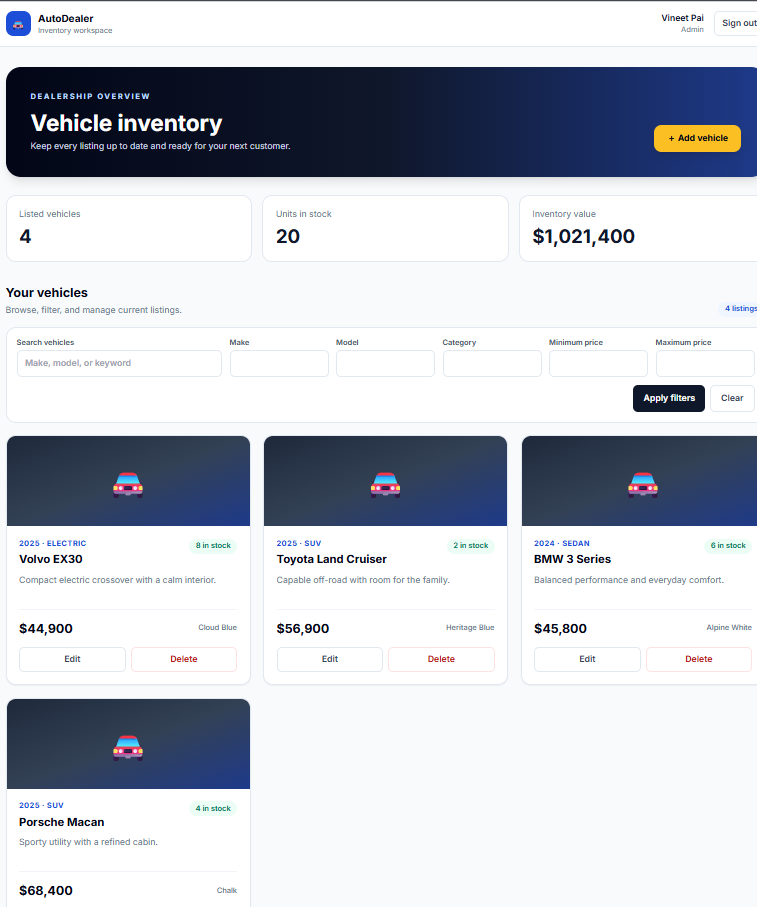
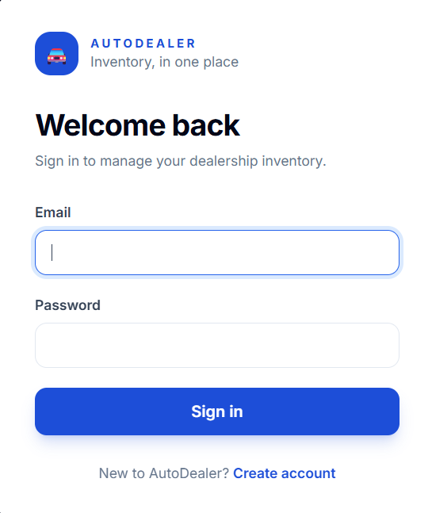
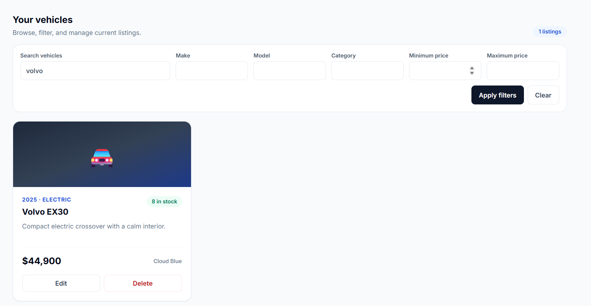
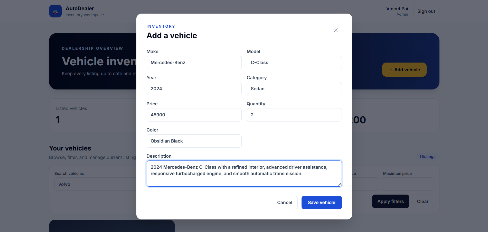
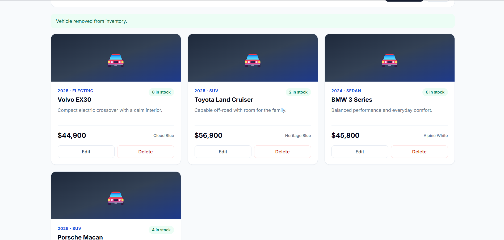
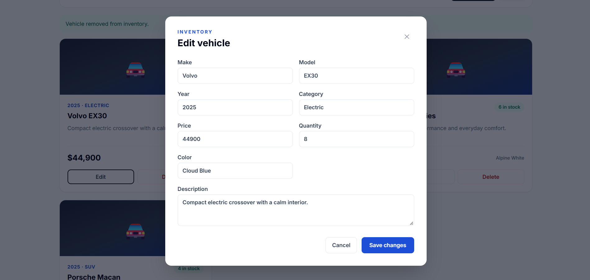

# Car Dealership Inventory System

A full-stack inventory application for a car dealership. Staff can register and sign in, browse and search vehicle listings, and (with an admin account) create, update, and delete inventory. The backend is an Express REST API backed by SQLite; the frontend is a React and TypeScript single-page app.

**Repository:** [VineetPai-coder/car-dealership-inventory-system](https://github.com/VineetPai-coder/car-dealership-inventory-system)

## Features

- User registration and login with bcrypt password hashing and JWT authentication.
- Role-based access: authenticated users can browse inventory; admins can manage it.
- Vehicle CRUD, text search and filters for make, model, category, and price.
- Search pagination using `limit` and `offset`.
- Purchase and restock operations backed by SQLite.
- Responsive React UI styled with Tailwind CSS, including loading and error states.
- Jest and Supertest unit, integration, and frontend tests.

## Tech Stack

- **Backend:** Node.js, TypeScript, Express, built-in `node:sqlite`, Zod, bcryptjs, jsonwebtoken
- **Frontend:** React, TypeScript, Vite, Tailwind CSS
- **Testing:** Jest, Supertest, React Testing Library, jest-html-reporter

## Getting Started & Local Development

### Prerequisites

- Node.js **22 or newer** (`node:sqlite` is built into Node and is required by the backend)
- npm
- Git

### Installation and Setup

1. Clone the repository and enter the project directory:

   ```bash
   git clone https://github.com/VineetPai-coder/car-dealership-inventory-system.git
   cd car-dealership-inventory-system
   ```

2. Install dependencies:

   ```bash
   npm install
   ```

3. Create the root `.env` file from the example:

   ```bash
   cp .env.example .env
   ```

   On Windows PowerShell, use `Copy-Item .env.example .env` instead. The example configures port `4000`, a local `dealership.db` database, and a development JWT secret. Replace `JWT_SECRET` with a long random value for any non-local environment. `.env` is ignored by Git.

   Available settings:

   | Variable | Default | Purpose |
   | --- | --- | --- |
   | `PORT` | `4000` | Express API port |
   | `NODE_ENV` | `development` | Runtime environment label |
   | `JWT_SECRET` | Example value in `.env.example` | Secret used to sign JWTs |
   | `DATABASE_PATH` | `dealership.db` | SQLite database file, relative to the project root |

   The database schema is created automatically when the server starts. A new local database has no vehicles seeded; add inventory through the dashboard after granting your account admin access.

4. Run the test suite:

   ```bash
   npm test
   ```

   Jest writes an HTML report to [`TEST_REPORT.html`](./TEST_REPORT.html). The last recorded full run passed **115 of 115 tests across 5 suites**. See [Test Report](#test-report).

5. Start the backend and frontend together:

   ```bash
   npm run dev
   ```

   Open the **Local** URL printed by Vite (normally [http://localhost:5173](http://localhost:5173)). The Vite development server proxies `/api` requests to the backend at `http://localhost:4000`. The backend health endpoint is [http://localhost:4000/api/health](http://localhost:4000/api/health).

### Admin Account for Local Development

Newly registered accounts have the `user` role. Vehicle create, update, and delete operations require an admin role. After registering, run this from the project root and replace the email with the account you registered:

```bash
node --input-type=module -e "import 'dotenv/config'; import { DatabaseSync } from 'node:sqlite'; import path from 'node:path'; const db = new DatabaseSync(path.resolve(process.env.DATABASE_PATH || 'dealership.db')); const result = db.prepare('UPDATE users SET role = ? WHERE email = ?').run('admin', 'you@example.com'); console.log(result.changes ? 'Admin role granted.' : 'No account found; register this email first.'); db.close();"
```

Sign out and sign in again after changing the role so the frontend receives a JWT with the updated role. Run the command against the same database configured for the backend in `.env`.

### Production Build and Start

Build the TypeScript backend and frontend assets, then start the server:

```bash
npm run build
npm start
```

The build command runs `build:server` and `build:client`. The production server listens on `PORT` (default `4000`) and serves the built frontend from `client/dist`.

## API Endpoints

All vehicle endpoints require a valid bearer token unless noted. Vehicle creation, update, deletion, and restocking are restricted to admins.

### Authentication — `/api/auth`

| Method and path | Access | Description |
| --- | --- | --- |
| `POST /api/auth/register` | Public | Register an account; validates input with Zod and returns a JWT and user |
| `POST /api/auth/login` | Public | Verify credentials and return a JWT and user |
| `GET /api/auth/me` | Authenticated | Return the current token's user profile |

### Vehicle Inventory — `/api/vehicles`

| Method and path | Access | Description |
| --- | --- | --- |
| `GET /api/vehicles` | Authenticated | List vehicles, newest first |
| `GET /api/vehicles/search` | Authenticated | Search and filter inventory; accepts `q`, `make`, `model`, `category`, `minPrice`, `maxPrice`, `limit`, and `offset` |
| `GET /api/vehicles/:id` | Authenticated | Get one vehicle |
| `POST /api/vehicles` | Admin | Add a vehicle |
| `PUT /api/vehicles/:id` | Admin | Update a vehicle |
| `DELETE /api/vehicles/:id` | Admin | Delete a vehicle |
| `POST /api/vehicles/:id/purchase` | Authenticated | Purchase one unit if the vehicle is in stock |
| `POST /api/vehicles/:id/restock` | Admin | Add stock to a vehicle |

Example vehicle payload:

```json
{
  "make": "Mercedes-Benz",
  "model": "C-Class",
  "year": 2024,
  "category": "Sedan",
  "color": "Obsidian Black",
  "price": 45900,
  "quantity": 2,
  "description": "Refined interior, advanced driver assistance, and a smooth automatic transmission."
}
```

## TDD and Git Workflow

Development followed the **Red-Green-Refactor** cycle across the project phases:

1. **Phase 0:** Scaffolding, architecture, database, and test harness.
2. **Phase 1:** Authentication, password hashing, and JWT authorization.
3. **Phase 2:** Vehicle inventory, CRUD, search, pagination, purchase, and restock APIs.
4. **Phase 3:** Frontend authentication, inventory dashboard, and responsive Tailwind styling.

The root [`PROMPTS.md`](./PROMPTS.md) contains the project AI conversation log. The Jest HTML reporter creates [`TEST_REPORT.html`](./TEST_REPORT.html) when the test suite runs.

## Screenshots

The following screenshots were supplied in `Screenshots.docx` and are included here as image files under [`docs/screenshots`](./docs/screenshots/).

### Admin Inventory Dashboard



### Login Screen



### Filtered Vehicle Search



### Add Vehicle



### Successful Deletion



### Edit Vehicle



## Test Report

The latest recorded full test run completed with:

| Result | Count |
| --- | ---: |
| Test suites passed | 5 / 5 |
| Tests passed | 115 / 115 |
| Snapshots | 0 |

Open the generated [Jest HTML test report](./TEST_REPORT.html) for suite-level details. Regenerate it at any time with `npm test`.

## My AI Usage

### AI tools used

- **Google Gemini through Antigravity** was used during project planning and implementation.
- **OpenAI Codex** was used for later development assistance, troubleshooting, and documentation work.

### How AI was used

- AI assistance helped plan the `src/app.ts` and `src/server.ts` separation and the phased TDD roadmap.
- It helped draft Jest and Supertest cases for authentication and vehicle inventory operations.
- It assisted with Zod validation, SQLite query implementation, React integration, Tailwind styling, and debugging.
- The project conversation log is available in [`PROMPTS.md`](./PROMPTS.md).

### Reflection

AI assistance reduced repetitive setup work and helped explore implementation options. The application was developed iteratively, with the test suite and build commands used to check the implementation. AI suggestions were reviewed and adjusted to fit the project structure and requirements. Relevant commits include the requested AI co-author attribution where applicable.

## License

This project was developed as part of an academic/professional assignment. No separate open-source license is provided.
